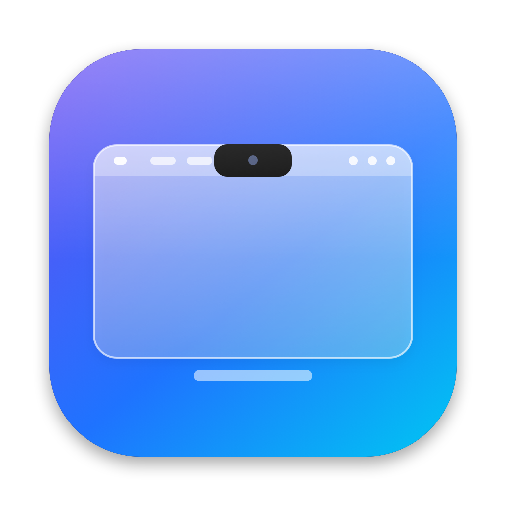
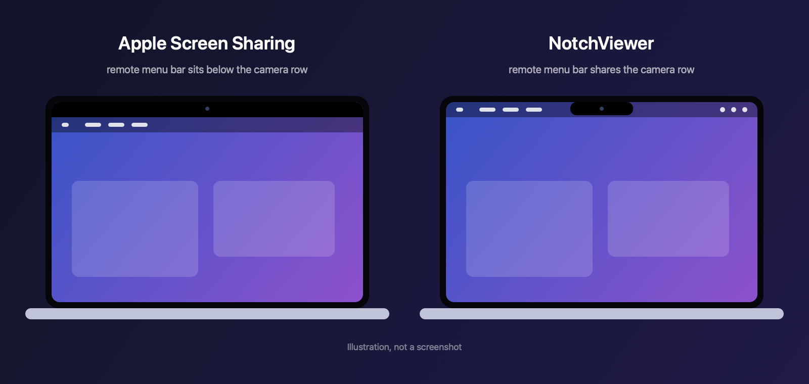

<p align="center"></p>

# NotchViewer

**Your other Mac, edge to edge, camera row included.**

## The pain point

Apple's Screen Sharing never maps the other Mac to your **full** screen. On a notched MacBook, macOS keeps its
window (even in full screen) below the camera housing, so the notch row is left empty and the remote Mac's menu
bar and picture are pushed down and squeezed. You are looking at a smaller, shifted copy of the other Mac, not the
whole screen.

NotchViewer fixes that. It is a small VNC viewer that draws the remote screen over the **entire** built-in
display, utilising the notch row, so the remote menu bar sits right beside the camera, as if you were sitting at
the other Mac. **That is where the name comes from: it's a viewer built around the notch.**

<p align="center"></p>

> **Status: early MVP (v0.1).** Built and tested on one pair of MacBook Pros (a 14" viewing a 16").
> Expect rough edges, and please open an issue with what you find.

## Features

- Full-display remote screen, including the notch row
- Liquid-glass connect window, with a morphing transition into the remote view
- **Touch ID unlock**: save the login once (Keychain), then just touch the sensor
- ZRLE-compressed updates (falls back to Raw automatically if a connection misbehaves)
- Auto-reconnect when the remote sends an all-black first frame (a quirk of Apple's server)
- Live colour modes (pass-through / Display P3 / sRGB) so you can match the two screens by eye
- Local escape hatch: **Control-Option-Command-Q** always disconnects

## Install

Download `NotchViewer.dmg` from Releases, or build it yourself (Xcode command-line tools, macOS 13+):

```bash
git clone <this repo>
cd NotchViewer
./scripts/make_dmg.sh        # builds NotchViewer.app and NotchViewer.dmg
```

The app is signed with a local self-signed identity (see `scripts/build_app.sh`), not an Apple Developer ID,
so macOS will warn the first time: right-click the app, choose **Open**.

## Set up the remote Mac

1. System Settings → General → Sharing → turn **Screen Sharing** on, then click its **(i)** button.
2. Turn on **Anyone may request permission to control screen**. (On the Macs we tested, the remote only sent
   a real picture with this on.)
3. Use a Mac account that is allowed under "Allow access for". Optionally set a VNC password and leave the
   username blank in NotchViewer.

## Use

1. Open NotchViewer, enter the remote Mac's address (for example `192.168.1.20`), username and password.
2. Leave **Remember this login** ticked to unlock with Touch ID next time.
3. Connect. Press **Control-Option-Command-Q** to disconnect.
4. **Control-Option-Command-C** cycles the colour mode while connected.

**Home and away:** enter more than one address, separated by commas, for example
`192.168.1.20, 100.64.0.5` (home Wi-Fi address first, then the other Mac's [Tailscale](https://tailscale.com)
address). NotchViewer uses the first one that answers, so at home it connects directly and anywhere else it goes
through Tailscale, starting the Tailscale app if needed. The saved login (and Touch ID) covers the whole list.

Two optional settings (Terminal):

```bash
defaults write dev.notchviewer.app colorSpace p3        # or srgb; delete the key for pass-through
defaults write dev.notchviewer.app fastDraw -bool true   # experimental GPU-surface drawing (can leave stale pixels)
```

## Security: please read

- VNC is **not encrypted** (the login is, the screen, mouse and keystrokes are not). Use it on a network you
  trust, and switch Screen Sharing off on the remote Mac when you are on shared Wi-Fi.
- The VNC-password option only uses the first 8 characters of the password.
- The saved login lives in your login Keychain and is released after Touch ID (or your Mac password).
- An SSH tunnel option would fix the encryption gap and is on the wish list.

## Known limits

- **No sound.** Plain VNC carries no audio. Apple's own Screen Sharing (High Performance mode) does.
- **Slower than Apple's Screen Sharing.** Apple's fast mode is private; third-party viewers get plain VNC.
- Command-key shortcuts and the cursor (you may see two) are not fully tuned.
- No clipboard sync, no multiple displays, no remote cursor shape.
- Colours are 8-bit with no profile attached; use the colour modes to match by eye.

## Project layout

```
Sources/NotchViewer   the viewer (RFB client, ARD/VNC auth, ZRLE decoder, AppKit UI)
Sources/CZlib         tiny zlib shim for ZRLE
scripts/              build_app.sh, make_dmg.sh, make_icon.swift
```

Run `./.build/release/NotchViewer --selftest` after building to check the big-integer maths used for login.

## Licence

MIT, see [LICENSE](LICENSE).
